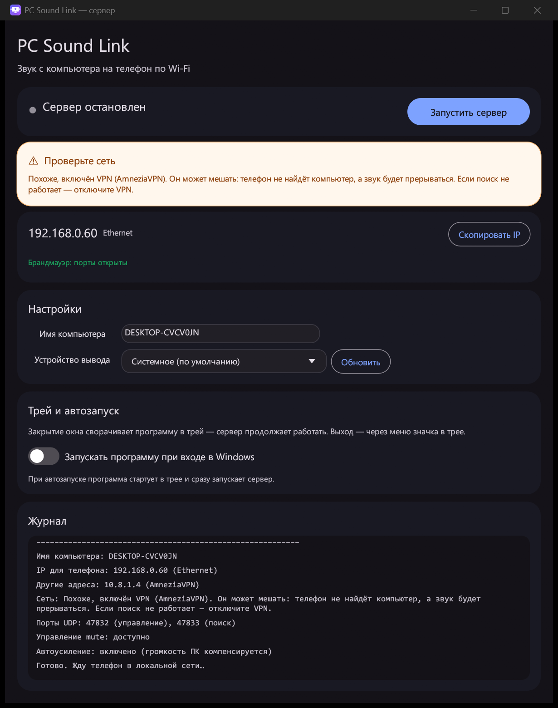

# PC Sound Link 🔊📱

Передаёт **звук с компьютера на телефон** по локальной сети Wi‑Fi с минимальной
задержкой. Телефон сам находит компьютер в сети, а звук на самом ПК можно
заглушить — он останется только в телефоне. Дополнительно приложение умеет
показывать экран ПК и работать как тачпад с клавиатурой.

```
┌──────────────┐   UDP 47832/47833   ┌────────────────┐
│  Windows ПК  │ ──────────────────► │  Android phone │
│ Rust server  │   PCM 48 кГц стерео │  PC Sound Link │
└──────────────┘                     └────────────────┘
```



## Возможности

- **Звук в реальном времени** — WASAPI loopback, PCM 16 бит, 48 кГц, стерео,
  кадры по 10 мс. Типичная задержка ~80–120 мс на Wi‑Fi 5 ГГц.
- **Автопоиск компьютера** — широковещательный UDP, IP можно ввести и вручную.
- **Заглушение динамиков ПК** — звук остаётся только в телефоне.
- **Демонстрация экрана** — JPEG‑поток по TCP, вписывается в экран целиком.
- **Тачпад и клавиатура** — жесты, правый клик, перетаскивание, ввод текста.
- **Портативный EXE** — без установки и без Python. Один файл.
- **Системный трей** — закрытие окна не останавливает сервер.
- **Автозапуск с Windows** — переключатель прямо в окне.
- **Брандмауэр** — порты открываются автоматически (один запрос UAC).
- **Предупреждения о сети** — VPN и нестандартные адаптеры видны сразу.
- **Тёмный интерфейс Material 3** — тот же стиль и палитра, что в Android‑приложении.

## Состав проекта

| Путь | Что это |
|---|---|
| `pc-server/pcsoundlink-server/` | Исходники сервера для Windows (Rust). |
| `android/` | Android‑приложение (Java, Material 3). |
| `assets/icons/` | Иконки `computer-wifi-sound.svg` и `phone-wifi-sound.svg`. |
| `docs/screenshots/` | Скриншоты интерфейса. |

Иконки SVG автоматически растрируются при сборке Rust‑сервера (`build.rs`,
crate `resvg`), поэтому готовый `.exe` уже содержит значок окна, трея и файла —
рядом с программой никаких картинок не нужно. В Android‑приложении та же
иконка телефона используется как значок запуска.

## Быстрый старт

### 1. Компьютер (Windows 10/11)

1. Скачайте `PcSoundLinkServer.exe` со страницы **Releases** (или соберите сами —
   см. ниже). Установка не требуется.
2. Запустите файл и нажмите **«Запустить сервер»**.
3. При первом запуске Windows спросит разрешение (UAC) — приложение откроет
   порты в брандмауэре. Готовность видна строкой
   **«Брандмауэр: порты открыты»**.
4. В окне появится IP компьютера и надпись «Сервер запущен».
5. Закрытие окна сворачивает программу в трей. Сервер продолжает работать.
   Вернуть окно — **«Показать окно»** в меню значка возле часов, полностью
   выйти — **«Выход»**.
6. В разделе **«Трей и автозапуск»** можно включить
   **«Запускать программу при входе в Windows»**. При следующем входе программа
   стартует скрыто в трее и сразу запускает сервер.

Если компьютер подключён к нестандартной сети или включён VPN, вверху окна
появится оранжевая карточка **«Проверьте сеть»**. Это предупреждение, а не
ошибка: если всё работает, его можно игнорировать.

### 2. Телефон (Android 7.0+)

1. Скачайте APK со страницы **Releases** и установите его (разрешите установку
   из неизвестных источников).
2. Убедитесь, что ПК и телефон в **одной сети** (один роутер).
3. Откройте приложение — оно само найдёт компьютер.
4. Нажмите **«Подключиться»**, если этого не произошло автоматически.
5. Переключатель **«Заглушить динамики ПК»** убирает звук с компьютера,
   оставляя его в телефоне.
6. **«Буфер / задержка»**: меньше — быстрее, но может «заикаться»; больше —
   стабильнее, но с задержкой.

Если поиск не сработал (роутер блокирует широковещательные пакеты) — введите
IP компьютера в поле **«IP компьютера вручную»** и нажмите «Подключиться».

Если на телефоне включён **VPN**, приложение покажет оранжевую карточку
**«Проверьте сеть»**: VPN может помешать найти компьютер и вызвать прерывания
звука.

## Сборка из исходников

### Сервер (Rust)

Нужны Rust (rustup) и компоненты сборки C++/MinGW для Windows.

```bat
cd pc-server\pcsoundlink-server
cargo build --release
```

Готовый файл: `target\release\pcsoundlink-server.exe`. Его можно переименовать
в `PcSoundLinkServer.exe`. Файл самодостаточен — зависимости и иконки уже
внутри.

Посмотреть список устройств вывода:

```bat
PcSoundLinkServer.exe --list-devices
```

### Android

Откройте папку `android` в Android Studio **или** выполните:

```bat
cd android
gradlew.bat assembleDebug
```

APK появится в `android\app\build\outputs\apk\debug\app-debug.apk`.

## Тачпад и демонстрация экрана

Кнопка «Тачпад и демо экрана» открывает полноэкранный тачпад: весь экран
телефона работает как тачпад, а поверх полупрозрачно показывается экран
компьютера. Демонстрация идёт по отдельному TCP‑соединению (ПК подключается к
телефону сам — обход брандмауэра ПК).

Жесты:

- 1 палец — двигает курсор;
- тап — левый клик;
- долгое нажатие — правый клик;
- двойное касание — зажать левую кнопку мыши: можно тянуть палец и
  перетаскивать окна; чтобы отпустить кнопку, коснитесь экрана ещё раз;
- 2 пальца — прокрутка (колёсико);
- тап двумя пальцами — правый клик.

Кнопка «Клавиатура» открывает клавиатуру телефона: набранный текст сразу
печатается на ПК (кириллица и латиница), Enter и Backspace тоже работают.
Кнопка «Скрыть экран» убирает картинку ПК, оставляя только тачпад.

Картинка экрана ПК всегда показывается целиком (вписывается без обрезки) и в
портретном, и в горизонтальном положении. Верхняя панель опускается ниже
«чёлки» камеры. Поворот телефона поддерживается. Если связь оборвалась,
демонстрация переподключается сама.

## Низкая задержка: советы

- Используйте **Wi‑Fi 5 ГГц**. 2.4 ГГц часто перегружен и даёт рывки.
- **Не** слушайте через Bluetooth‑наушники — Bluetooth сам добавляет 100–200 мс.
  Для минимума задержки — динамик телефона или проводные наушники.
- Поставьте буфер 20–40 мс, если сеть стабильная.
- Держите телефон рядом с роутером; отключите VPN на телефоне и ПК.
- На телефоне отключите экономию энергии для приложения (OnePlus/Xiaomi и др.
  любят «усыплять» фоновые сервисы).

## Если что-то не работает

**Компьютер не находится**

- ПК и телефон точно в одной сети? (не «гостевая» сеть Wi‑Fi)
- Запущен ли `PcSoundLinkServer.exe`? Проверьте строку про брандмауэр: если
  написано «доступ не разрешён», нажмите **«Открыть порты»** и подтвердите
  запрос Windows.
- Отключите VPN и виртуальные адаптеры — они иногда «забирают»
  широковещательные пакеты. IP можно ввести вручную.

**Подключился, но тишина**

- Звук на ПК вообще играет? Проверьте `PcSoundLinkServer.exe --list-devices` —
  сервер захватывает устройство по умолчанию или выбранное в окне.
- Громкость Windows не должна быть ровно в нуле: из нуля усиливать нечего.
  Mute — можно, автоусиление всё равно доведёт сигнал до максимума.

**Прерывается / щёлкает**

- Увеличьте буфер до 100–150 мс.
- Переключитесь на 5 ГГц или подвиньте телефон ближе к роутеру.

**Тишина на самом ПК, а надо, чтобы играло и там**

- Выключите «Заглушить динамики ПК».

## Как это устроено (кратко)

- **Поиск**: телефон шлёт UDP‑широковещательный запрос на порт 47833, сервер
  отвечает своим именем и id. Плюс сервер раз в 2 секунды сам объявляет о себе.
- **Управление**: JSON‑команды на UDP 47832 (`start`, `stop`, `ping`, `mute`).
- **Звук**: PCM 16 бит, 48 кГц, стерео. Кадр 10 мс (1920 байт) бьётся на
  MTU‑безопасные датаграммы по ~976 байт, чтобы не было IP‑фрагментации.
- **Экран**: GDI BitBlt/StretchBlt + курсор, JPEG q55, ширина до 1280 px,
  15 кадров/с, TCP с длиной кадра `[u32 LE]`.
- **На телефоне**: адаптивный джиттер‑буфер, `AudioTrack` в режиме
  `PERFORMANCE_MODE_LOW_LATENCY`, выравнивание дрейфа часов ПК/телефона.
- **Фон**: воспроизведение живёт в foreground‑сервисе с Wi‑Fi и wake‑lock.

## Стек

- Сервер: Rust, `eframe`/`egui`, `wasapi`, `windows`, `tray-icon`, `image`,
  `resvg` (иконки на этапе сборки).
- Приложение: Java, AndroidX, Material Components 3.
